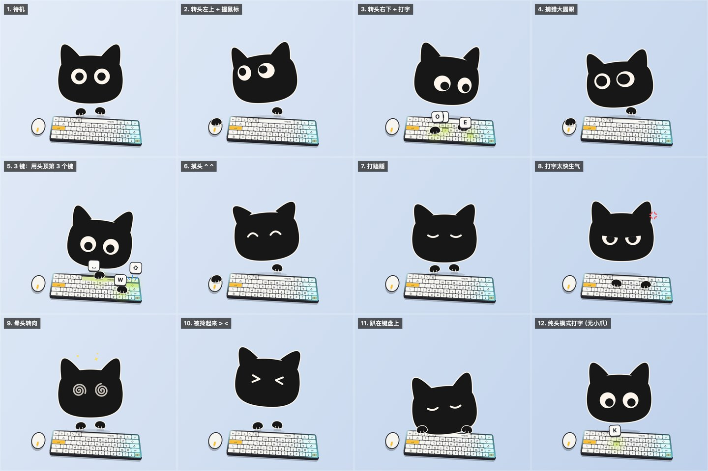

# 小黑桌宠（Xiaohei Pet）

小黑 OmniBox 的 macOS 键盘桌宠。小黑躲在键盘后探头，跟着你打字、移动鼠标，也会打瞌睡。

## 下载与安装

支持 macOS 11 或更新版本，适用于 Apple 芯片和 Intel 芯片的 Mac。

1. 从 [GitHub Releases](https://github.com/import-ai/omnibox-pet/releases) 下载 `XiaoheiPet-macOS-universal.zip`。如果还没有正式版本，可登录 GitHub，从 [最近一次成功的主分支构建](https://github.com/import-ai/omnibox-pet/actions/workflows/build.yml?query=branch%3Amain+is%3Asuccess) 下载 `XiaoheiPet-macOS-universal`，再解压其中的应用 ZIP。
2. 解压后，将 `XiaoheiPet.app` 拖到「应用程序」，然后打开。
3. 在「系统设置 → 隐私与安全性 → 输入监控」里启用「小黑桌宠」，再从菜单栏小黑图标选择「重启小黑桌宠」。如果更新后小爪对键盘没反应，可以在同一位置重新授权。

## 和小黑互动

- 打字和使用鼠标时，悬浮小爪会跟着按键和握鼠标。
- 摸摸小黑的头，它会眯眼。闲置一会儿，它会打瞌睡。
- 右键点击小黑或点击菜单栏图标可打开菜单。关闭「显示悬浮小爪」后，小黑仍会朝按下的键点头。

## 来源

本项目 Fork 自 [chanke17/KuroCat](https://github.com/chanke17/KuroCat)，采用 [MIT 许可证](LICENSE)。
